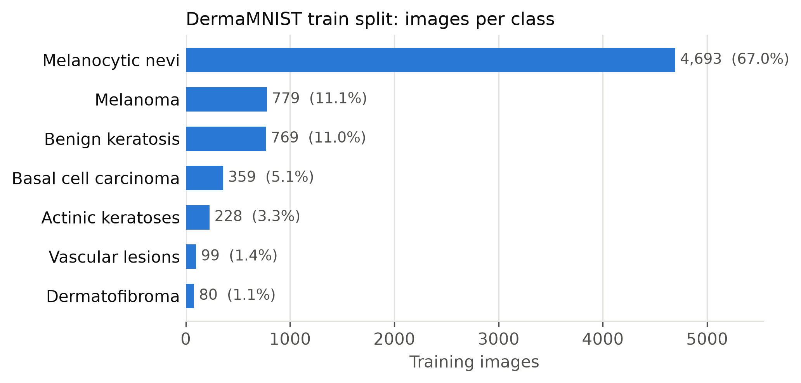
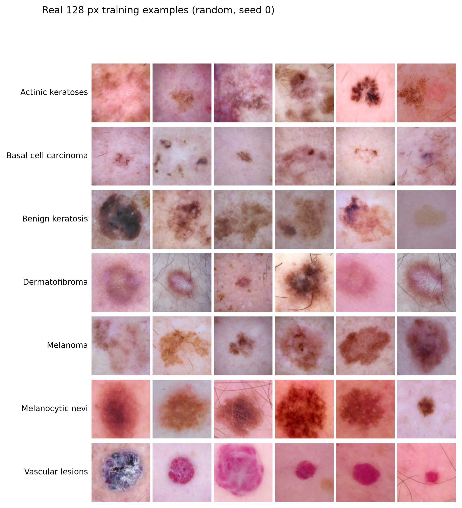
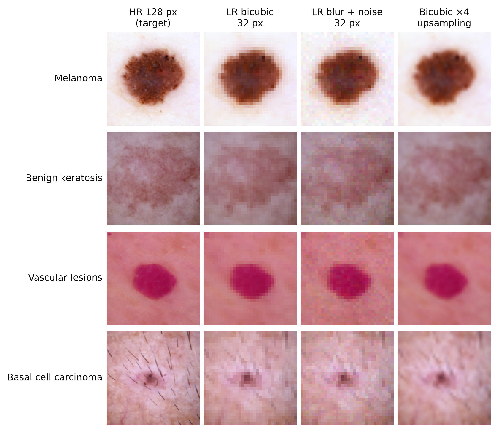

# Fiche de données — MedSuperRes Gen

Jeu de données utilisé pour la super-résolution ×4 (32 → 128 px) de lésions cutanées par SRGAN
(projet *IA générative visuelle*, Fiche 07).

| | |
|---|---|
| Jeu source | DermaMNIST, version 128×128 (MedMNIST+, v3.0) |
| Origine | HAM10000 (Tschandl et al., 2018), via MedMNIST (Yang et al., 2023) |
| Licence | CC BY-NC 4.0 (images DermaMNIST et HAM10000) — usage non commercial |
| Tâche | Super-résolution ×4 ; évaluation par classification multiclasse (7 classes) |
| Images | 10 015 images RGB dermatoscopiques, 128×128 px |
| Partitions | Officielles MedMNIST : 7 007 train / 1 003 val / 2 005 test |
| Redistribution | Aucune image source dans ce dépôt ; `src/prepare_data.py` les télécharge |

## 1. Composition

Images dermatoscopiques de lésions pigmentées, une étiquette diagnostique par image.

| ID | Classe | Train | Val | Test | % train |
|---:|---|---:|---:|---:|---:|
| 0 | Kératoses actiniques et carcinome intra-épithélial | 228 | 33 | 66 | 3,3 |
| 1 | Carcinome basocellulaire | 359 | 52 | 103 | 5,1 |
| 2 | Lésions de type kératose bénigne | 769 | 110 | 220 | 11,0 |
| 3 | Dermatofibrome | 80 | 12 | 23 | 1,1 |
| 4 | Mélanome | 779 | 111 | 223 | 11,1 |
| 5 | Nævus mélanocytaire | 4 693 | 671 | 1 341 | 67,0 |
| 6 | Lésions vasculaires | 99 | 14 | 29 | 1,4 |
| | **Total** | **7 007** | **1 003** | **2 005** | |

Source : `splits/class_counts.csv`.



**Déséquilibre fort** : le nævus représente 67 % du train, le dermatofibrome 1,1 % (80 images).
Conséquences pour le protocole : la F1 macro et le rappel par classe sont les métriques principales,
pas l'exactitude ; les scores des classes rares (23 dermatofibromes, 29 lésions vasculaires en test)
ont une forte variance et sont accompagnés d'intervalles de confiance à 95 % par bootstrap.



Observations visuelles : poils traversant la lésion, cadrage et zoom variables, vignettage du
dermatoscope, teintes de peau et éclairage hétérogènes. Les lésions vasculaires (rouges) sont
visuellement distinctes ; mélanome, nævus et kératose bénigne se ressemblent, ce sont les classes où
une super-résolution qui altère la texture risque le plus de changer la prédiction.

## 2. Partitions

- Partitions **officielles** MedMNIST+, ni remélangées ni modifiées.
- Figées et versionnées dans `splits/{train,val,test}.csv` : index, étiquette et empreinte SHA-1 de
  chaque image HR. Toute modification des données change les empreintes et est donc détectable.
- **Usage** : le train sert à entraîner les générateurs et le classifieur d'évaluation ; la validation
  sert à la sélection des checkpoints et des hyperparamètres ; le **test n'est jamais utilisé** pour
  entraîner, régler ou sélectionner quoi que ce soit.
- Les figures de cette fiche n'utilisent que le train.

## 3. Prétraitement et paires basse / haute résolution

- Cible haute résolution (HR) : image DermaMNIST 128×128 telle que fournie (uint8, RGB). Aucun
  agrandissement : la résolution annoncée ne dépasse jamais celle des données.
- Les entrées basse résolution (LR, 32×32) sont calculées depuis la HR par deux dégradations,
  paramètres dans `splits/degradation.json` :

| Dégradation | Opérations | Paramètres |
|---|---|---|
| Bicubique (principale) | sous-échantillonnage bicubique ×4 | PIL `Image.BICUBIC` |
| Flou + bruit (robustesse) | flou gaussien sur la HR → bicubique ×4 → bruit gaussien additif | σ flou = 1,0 px ; σ bruit = 5/255 ; graine 2026 |



La dernière colonne (agrandissement bicubique ×4) est la référence non apprise que les modèles
doivent dépasser.

Fichiers produits (non versionnés) : `data/processed/{split}.npz` contenant `hr`, `lr_bicubic`,
`lr_degraded`, `labels`.

## 4. Usage prévu et non prévu

**Prévu** : recherche et enseignement sur la super-résolution générative ; mesure de la stabilité
des caractéristiques de lésion et de l'effet de la super-résolution sur un classifieur.

**Non prévu** : tout usage diagnostique ou clinique. Les images super-résolues peuvent contenir des
détails hallucinés (bordures, texture, réseau pigmentaire, poils) ; elles ne sont pas des
observations et ne doivent jamais servir de preuve diagnostique. Usage commercial exclu par la licence.

## 5. Limites et biais connus

- **Fuite entre partitions (lésions répétées).** HAM10000 contient 10 015 images de 7 470 lésions ;
  environ 26 % des lésions ont plusieurs images. Les partitions officielles de DermaMNIST ne sont
  pas faites par lésion : Abhishek et al. (2024) rapportent 886 images (641 lésions) partagées entre
  train et test, 440 entre train et validation et 128 entre validation et test, ainsi que des
  quasi-doublons non détectés. Nous conservons les partitions officielles, comme l'exige la fiche
  du projet, et signalons que les scores de test peuvent être optimistes, en particulier pour la
  mémorisation. Des versions corrigées (DermaMNIST-C, DermaMNIST-E) existent mais ne sont publiées
  qu'en 28 et 224 px ; elles pourraient servir de contrôle complémentaire.
- **Étiquettes** : les mêmes auteurs signalent des images mal étiquetées dans HAM10000 /
  DermaMNIST ; non corrigées ici.
- **Déséquilibre** : voir section 1 ; peu d'exemples pour les classes 3 et 6.
- **Résolution** : les images 128 px sont déjà réduites depuis les originaux HAM10000 ; la
  « vérité » HR de ce projet est donc elle-même une image sous-échantillonnée.
- **Dégradation simulée** : les entrées LR sont synthétiques, pas des acquisitions réelles à basse
  résolution ; les résultats ne se transfèrent pas automatiquement à de vraies images basse qualité.
- **Représentativité** : population, appareils et teintes de peau limités à ceux de HAM10000 ; les
  peaux foncées y sont peu représentées.

## 6. Reproductibilité

```bash
pip install -r requirements.txt
python src/prepare_data.py --out data          # données, LR, partitions, effectifs
python src/make_data_card_figures.py           # figures de cette fiche
```

Les empreintes SHA-1 de `splits/*.csv` permettent de vérifier qu'une reproduction retrouve
exactement les mêmes images.

## 7. Références

- Tschandl P., Rosendahl C., Kittler H. *The HAM10000 dataset, a large collection of multi-source
  dermatoscopic images of common pigmented skin lesions.* Scientific Data, 2018.
- Yang J. et al. *MedMNIST v2 — A large-scale lightweight benchmark for 2D and 3D biomedical image
  classification.* Scientific Data, 2023.
- Abhishek K., Jain A., Hamarneh G. *Investigating the Quality of DermaMNIST and Fitzpatrick17k
  Dermatological Image Datasets.* Scientific Data, 2025. arXiv:2401.14497.

## 8. Responsables

Groupe : _à compléter (noms des membres)_.
Assistance IA : rédaction assistée par Claude (Anthropic), déclarée dans le README.
